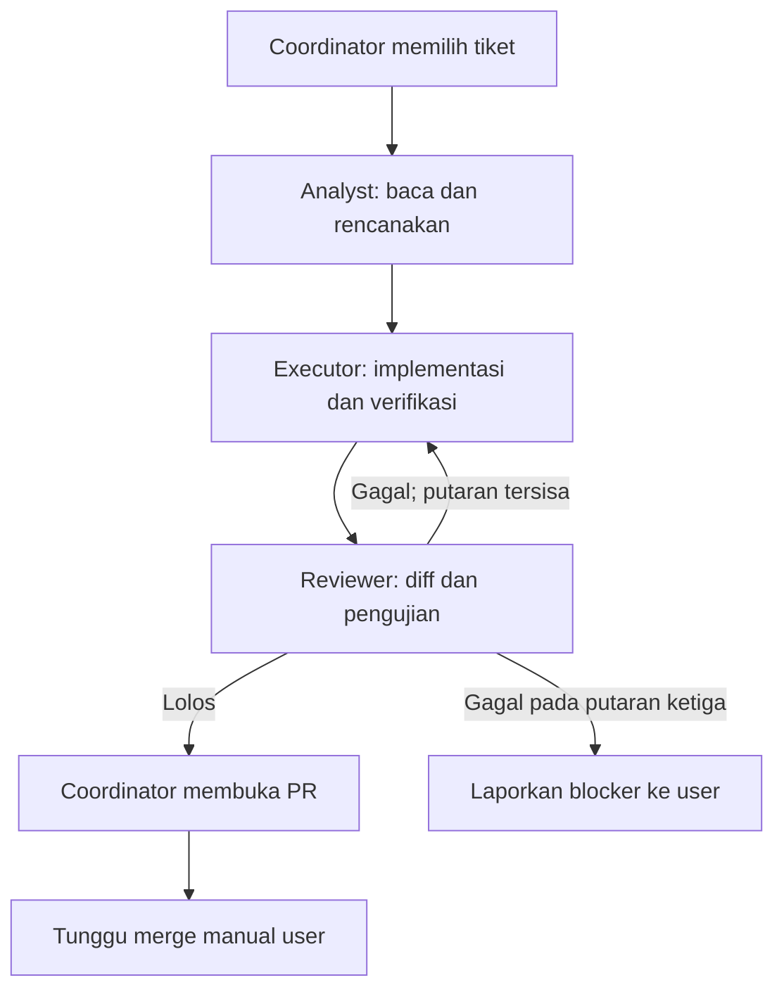

# AGENTS.md — Rootin Mobile (Flutter)

Revisi 4 — Flutter + Dart; aplikasi iOS/Android baru dari nol. Pelacakan tiket menggunakan GitHub Issues dan GitHub Projects. Rootin Web tetap terpisah.

Aturan untuk agent AI yang bekerja di repository Rootin. Alur Git, commit, dan pull request mengikuti `docs/00-alur-kerja-git.md`. Semua laporan ditulis dalam bahasa Indonesia; judul commit dan PR mengikuti Conventional Commits.

## 1. Konteks proyek dan sumber kebenaran

- Produk: Rootin Mobile, aplikasi pengingat perawatan/penggantian rutin berdasarkan waktu, jumlah pemakaian dan jarak tempuh; profil barang, foto, kalender dan riwayat.
- **Platform target: iOS dan Android, menggunakan Flutter + Dart. Proyek dibangun dari nol.**
- Rootin Web dipertahankan sebagai proyek terpisah. Pekerjaan mobile tidak mengubah, menghapus, mengonversi atau bergantung pada repository, runtime maupun deployment Rootin Web.
- Repository tiket: https://github.com/andresanjaya/rootin; daftar issue: https://github.com/andresanjaya/rootin/issues.
- GitHub Project: https://github.com/users/andresanjaya/projects/4/views/1?system_template=kanban. Gunakan project ini untuk status kerja; periksa field dan opsi yang tersedia sebelum mengubah status. Keberadaan issue tidak membuktikan bahwa issue sudah ditambahkan ke Project atau statusnya sudah disinkronkan.
- Repository kode mobile: gunakan ROOTIN_MOBILE_REPO_URL dan path checkout yang diverifikasi dalam Run. Jangan menganggap repository issue tracker adalah repository kode mobile sebelum remote dan baseline diverifikasi.
- ID stabil: ROOTIN-M000 (roadmap) dan ROOTIN-M001 sampai ROOTIN-M027. Setiap tiket kerja memiliki GitHub Issue; cocokkan ID di judul issue dengan nomor issue aktual sebelum memakai nomor tersebut.

### Sumber kebenaran

1. Instruksi terbaru user dan aturan keselamatan/akses lingkungan.
2. AGENTS.md yang berlaku dan aturan subfolder yang relevan.
3. ADR accepted yang sesuai dengan keputusan Flutter mobile terbaru; keputusan yang sudah digantikan tidak aktif.
4. Acceptance criteria tiket, PRD mobile dan kontrak backend yang disepakati.
5. Source/migrasi/tes di repository kode mobile sebagai bukti implementasi aktual.
6. GitHub Issue sebagai sumber scope dan acceptance criteria; GitHub Project sebagai sumber status workflow. Jika issue dan status Project tidak selaras, Coordinator mencatat perbedaannya dan tidak menebak status.

Keputusan Flutter dan pembangunan dari nol sudah ditetapkan user. Syarat backlog/dokumen lama mengenai stack sebelumnya, migrasi source website, berbagi package dengan web atau menjaga regresi browser sudah digantikan. Coordinator memetakan scope fungsional ke Flutter, mencatat penyesuaian di spec, dan memperbarui issue atau status Project bila perubahan tersebut termasuk otorisasi Run. Jangan meminta user memilih kembali keputusan ini.

Kode Rootin Web boleh menjadi referensi perilaku bila dibutuhkan secara eksplisit. Tidak ada kewajiban memakai ulang source, akun, database, key, migrasi atau Supabase project website. Kemampuan yang belum ada pada mobile harus dirancang dan diuji dari awal; kesamaan nama produk bukan bukti implementasi atau izin mengakses data proyek lain.

### Stack produk

| Area | Pilihan |
| --- | --- |
| Framework dan bahasa | Flutter + Dart |
| State management dan dependency injection | Riverpod |
| Navigasi | go_router |
| UI dan tema | Material 3 kustom Rootin; gunakan pola/kontrol adaptif atau Cupertino bila sesuai interaksi iOS |
| Database lokal | Drift + SQLite |
| Backend | Supabase Auth, PostgreSQL, RLS, Storage privat, RPC/fungsi backend sesuai kebutuhan |
| Pengingat lokal | flutter_local_notifications dengan timezone dan ID occurrence yang konsisten |
| Remote push bila diperlukan | Firebase Cloud Messaging melalui firebase_messaging; konfigurasi APNs pada iOS |
| Billing | RevenueCat melalui purchases_flutter pada scope monetisasi |
| Pengujian | flutter_test, tes unit/widget dan integration_test sesuai fitur |
| Build/distribusi | Toolchain Flutter Android/iOS; signed build untuk Google Play dan App Store/TestFlight sesuai tahap |

Versi SDK/package dipilih melalui pemeriksaan kompatibilitas dan dikunci. Jangan menambahkan state-management kedua, HTTP client, code generation, sync service, atau UI kit tambahan tanpa kebutuhan dalam rencana Analyst. Riverpod, go_router atau Drift tidak otomatis menyelesaikan konflik sinkronisasi dan retry.

Desain backend mobile dilakukan untuk kebutuhan produk baru. Default environment mobile diisolasi dari Rootin Web; penggunaan Supabase project/data bersama harus merupakan keputusan tersendiri yang eksplisit. Jangan membuat project berbayar, merotasi key, atau mengubah layanan website sebagai efek samping scaffold. Kode privileged dan service-role key tetap di backend.

### Struktur target Flutter

Gunakan satu aplikasi Flutter di root repository mobile. Struktur berikut adalah rancangan awal, bukan klaim folder sudah tersedia:

| Path | Tanggung jawab |
| --- | --- |
| pubspec.yaml dan pubspec.lock | SDK, dependency dan versi hasil resolusi aplikasi |
| lib/main.dart | Entry point |
| lib/app/ | Bootstrap, konfigurasi router, tema dan app shell |
| lib/core/ | Komponen/infrastruktur lintas fitur yang benar-benar dibutuhkan |
| lib/features/<fitur>/presentation/ | Screen/widget serta controller atau notifier Riverpod |
| lib/features/<fitur>/data/ | Repository, DTO dan adapter lokal/remote terkait fitur |
| lib/features/<fitur>/domain/ | Aturan bisnis/use case Dart murni bila kompleksitas membutuhkannya |
| test/ | Tes unit dan widget |
| integration_test/ | Alur integrasi mobile sesuai scope |
| android/ dan ios/ | Project native, permission, signing reference dan konfigurasi platform |
| assets/ | Ikon, splash, font serta gambar |
| supabase/migrations/ dan supabase/functions/ | Migrasi/RLS/RPC dan fungsi backend mobile saat diperlukan |
| docs/ | PRD mobile, desain, arsitektur, kontrak dan ADR |

Pisahkan UI, state, repository dan layanan data. Tambahkan domain layer jika aturan bisnis memang membutuhkannya; jangan membuat abstraksi kosong untuk setiap aksi. Repository menyajikan data ke aplikasi dengan aturan lokal/remote yang jelas. Sync engine mengelola operation_id, outbox, revision/conflict dan tombstone secara eksplisit.

Tidak ada target website, PWA atau wrapper WebView dalam repository mobile. Android dan iOS adalah output yang diuji; kesamaan UI kedua platform tidak menghapus kebutuhan penyesuaian lifecycle, izin, gesture dan aksesibilitas.

Dokumen target dibuat melalui tiket terkait:

- docs/01-project-overview.md: arsitektur Flutter/backend dan struktur aktual.
- docs/02-mobile-prd.md: scope dan acceptance criteria mobile.
- docs/03-mobile-ux.md dan docs/04-mobile-design-system.md: flow, layar, token dan komponen Flutter.
- docs/05-database-design.md: Drift/SQLite, skema server, RLS/RPC, sync dan migrasi.
- docs/06-api-design.md: kontrak backend yang digunakan mobile.
- docs/decisions/*.md: keputusan accepted dan keputusan yang digantikan.

Jangan mengklaim folder, script, kontrak OpenAPI atau layanan yang belum dibuat sebagai tersedia.

## 2. Runner dan pemetaan model

Semua peran menggunakan **OpenCode sebagai runner**. Model adalah konfigurasi di dalam runner; penggunaan model OpenAI atau Anthropic tidak berarti berpindah ke Codex CLI atau Claude Code.

| Peran | Model rekomendasi | Pengaturan awal |
| --- | --- | --- |
| Coordinator | GPT-6.1 Sol | reasoning high jika adapter mendukung |
| Analyst | GPT-6.1 Sol | reasoning high jika adapter mendukung |
| Executor | Claude Sonnet 5.5 | effort bawaan provider; evaluasi dengan tes proyek |
| Reviewer / Tester | GPT-6.1 Sol | reasoning high jika adapter mendukung |

Ini rekomendasi pemilihan model, bukan jaminan akses akun. Sebelum Run:

1. Periksa versi OpenCode/orca dan help lokal; jangan mengasumsikan sintaks V1/V2 sama.
2. Jalankan `opencode models` dan cocokkan referensi provider/model yang tersedia.
3. Contoh kandidat: `openai/gpt-6.1-sol`, `opencode/gpt-6.1-sol` untuk provider Zen, dan `anthropic/claude-sonnet-5-5`. Pakai hanya ID persis yang terdaftar dan berhasil diakses.
4. Bekukan model map ke `COORDINATOR_MODEL_REF`, `ANALYST_MODEL_REF`, `EXECUTOR_MODEL_REF`, `REVIEWER_MODEL_REF` dalam metadata Run. Nama ini adalah kontrak metadata tim, bukan environment variable bawaan orca/OpenCode.
5. Uji akses provider dengan tugas ringan pada preflight yang diizinkan; daftar katalog saja belum membuktikan autentikasi/quota berfungsi.
6. Model yang dipilih harus tampak pada metadata worker. Jangan mengganti model, provider, runner, atau melakukan eskalasi berbayar secara diam-diam.

Jika model/CLI tidak tersedia, laporkan blocker konkret lewat kanal `ask` yang disediakan lingkungan. Jangan menebak flag seperti `orca --model` atau mengklaim konfigurasi aktif hanya karena prompt menyebut model.

## 3. Alur orkestrasi

- Satu tiket dijalankan berurutan: Analyst → Executor → Reviewer.
- Coordinator mengatur Run, spec, worktree, model map, laporan, status GitHub Project, dan PR.
- Default satu tiket aktif. Maksimal dua tiket bila user mengaktifkan batch dan ownership, dependensi, serta sumber daya pengujian tidak tumpang tindih.
- Jangan mengerjakan tiket lanjutan yang bergantung pada PR belum di-merge. Dasar setiap tiket tetap `origin/main` terbaru, tanpa stacked branch.
- Worker hanya mengerjakan spec-nya dan tidak memilih tiket berikutnya.
- Maksimal tiga pasangan Executor–Reviewer per tiket: implementasi awal + dua revisi. Pada kegagalan review ketiga, berhenti untuk tiket tersebut dan laporkan temuan tersisa.
- Kendala akses/environment dicatat `BLOCKED`, bukan dianggap hasil test lolos atau alasan untuk mengulang tanpa batas.
- Selesai review bukan selesai tiket: state akhir agent adalah `PR_OPEN / WAITING_USER_MERGE`.

### Preamble dan lifecycle worker

- Mulai worker melalui mekanisme orca yang telah diverifikasi dengan runner `--agent opencode`.
- `--agent opencode` pada worker-start memilih runner; pemilihan profil peran/model OpenCode adalah konfigurasi terpisah yang harus diperiksa.
- Gunakan command `ask` dari preamble untuk pertanyaan penghambat. Jangan meminta input interaktif di terminal atau menganggap diamnya user sebagai jawaban.
- Ketika pekerjaan worker berakhir, panggil tepat satu `worker_done` dengan `--outcome succeeded` atau `--outcome failed` menurut kontrak preamble.
- Jangan mengarang Run ID, worker ID, token penyelesaian, atau flag yang tidak ada pada help/preamble.
- Coordinator tidak menandai worker lain selesai, mengirim completion ganda, atau memakai outcome succeeded untuk menyembunyikan blocker.
- Jika completion gagal transport, gunakan prosedur rekonsiliasi orca. Jangan mengirim completion kedua tanpa mengetahui status yang pertama.

## 4. Spec yang wajib berdiri sendiri

Setiap spec memuat bagian berikut, termasuk untuk revisi:

1. **Target:** ID ROOTIN-Mxxx, nomor dan URL GitHub Issue, status Project yang sudah diverifikasi, tujuan pengguna, acceptance criteria, branch, worktree, base SHA, dan head SHA untuk review.
2. **Change:** scope yang diizinkan, urutan implementasi/analisis, kontrak data dan keputusan yang relevan.
3. **Constraints:** batas peran, runner/model map, larangan main/merge, aturan privasi, database, dependency, dan verifikasi.
4. **Ownership:** daftar path/glob eksplisit; file bersama dan lockfile dinyatakan terpisah. Baca konteks di luar ownership boleh; mengubahnya tidak boleh tanpa spec direvisi.
5. **Acceptance:** checklist tiket, perintah verifikasi, bukti platform, serta format laporan/outcome.

Tambahkan `Round: 1/3`, `2/3`, atau `3/3`. Pada revisi, sertakan temuan Reviewer dan hasil yang harus diperbaiki; jangan mengganti acceptance criteria untuk melewati temuan.

## 5. Branch dan worktree

- Setiap tiket memakai branch/worktree sendiri dari `origin/main` terbaru. Tidak ada implementasi di main atau branch tiket lain.
- Nama branch menggunakan nomor GitHub Issue aktual: `<type>/<nomor-issue>-<slug>`, misalnya `docs/27-prd-mobile` atau `chore/6-flutter-scaffold`. ID ROOTIN-Mxxx tetap dicatat di spec dan PR; jangan memakai ID produk sebagai nomor issue.
- Aturan lengkap, tipe branch, prosedur worktree, dan pembuatan PR ada di `docs/00-alur-kerja-git.md`.
- Coordinator membuat worktree sebelum Executor; Analyst boleh membaca checkout current yang benar dan mencatat SHA.
- Revisi menggunakan branch/worktree yang sama; jangan membuat branch baru setiap putaran.
- Executor dan Reviewer wajib memeriksa branch, root worktree, base/head, dan kondisi working tree. Ketidaksesuaian harus diselesaikan lewat `ask`.
- Jangan membersihkan worktree/branch setelah PR dibuka. Penghapusan hanya setelah user memerintahkan dan status merge diverifikasi.

## 6. Tanggung jawab peran

### Coordinator

- Baca GitHub Issue dan dependensi terbaru. Gunakan status GitHub Project untuk memilih pekerjaan Ready; bila issue belum menjadi item Project atau field status tidak tersedia, verifikasi melalui jalur GitHub yang tersedia dan laporkan status yang belum tersinkron. Jangan menganggap issue open otomatis berarti Ready.
- Pertahankan ID ROOTIN-Mxxx, nomor/URL issue, URL Project dan status yang diverifikasi, Run, branch/worktree, base/head SHA, model map, putaran, laporan, serta PR URL.
- Tulis spec dan metadata orchestration di area orchestration yang disediakan; jangan mengedit source aplikasi, tes, migrasi, dokumentasi repository, atau lockfile sendiri.
- Perubahan repository, termasuk bootstrap dokumentasi/agent, didelegasikan kepada Executor dengan ownership eksplisit.
- Periksa rencana Analyst mencakup dependency baru, script verifikasi, risiko, serta kebutuhan perubahan dokumen sebelum mulai Executor.
- Temuan review dikirim kembali ke Executor. Coordinator tidak memperbaiki kode dan tidak menyetujui PR.
- Sebelum PR, cocokkan HEAD dengan SHA yang diluluskan Reviewer. Bila head atau base yang relevan berubah, lakukan review ulang; jangan memakai laporan basi.
- Setelah review lolos, buka PR dan pindahkan item GitHub Project ke Review dengan tautan PR serta ringkasan hasil bila perubahan status termasuk otorisasi Run dan tool yang tersedia mendukungnya. Jika tidak, laporkan blocker; jangan mengklaim status sudah berubah. Jangan menandai Done atau menutup issue.
- Setelah PR terbuka, jangan mengambil tiket baru dalam Run tersebut. Untuk batch yang sudah aktif, tuntaskan/hentikan worker secara tertib dan laporkan setiap hasil.

### Analyst — read-only

- Baca tiket, accepted ADR, PRD, source/migrasi, tes dan konfigurasi terkait.
- Dilarang membuat/mengedit/menghapus file repository, melakukan install/migration, commit, push, atau implementasi.
- Kembalikan laporan melalui output worker/metadata orchestration; jika report file diperlukan, Coordinator menyimpannya di area orchestration, bukan Analyst menulis source.
- Laporan wajib berisi: ringkasan/AC; kondisi repository Flutter dan gap terhadap target; file yang akan dibuat/diubah; langkah implementasi; ownership; dependency dalam pubspec; konflik keputusan lama; risiko data; serta command dan bukti pengujian Android/iOS yang diperlukan.
- Jika AC belum jelas, gunakan ask. Pekerjaan non-blocking boleh dianalisis sambil menunggu; jangan mengarang keputusan produk.

### Executor

- Sebelum edit, buktikan branch/worktree sesuai spec dan baca AGENTS.md yang berlaku di path tersebut.
- Implementasikan rencana Analyst hanya dalam ownership. Minta perubahan spec jika file tambahan ternyata diperlukan.
- Tambahkan dependency hanya jika tercantum dalam rencana Analyst dan sesuai scope; perubahan manifest serta lockfile harus masuk ownership.
- Jika DB/RPC berubah, tambahkan migrasi baru dan perbarui dokumentasi data/kontrak terkait dalam commit yang sama. Jangan mengubah migrasi yang telah dipakai sebagai cara memodifikasi produksi.
- Jika API berubah, perbarui kontrak dan client terkait yang sudah diadopsi; jangan membuat schema/openapi rekaan agar memenuhi template.
- Jalankan verifikasi sendiri, catat exit code dan batas pengujian. Jangan menulis “lulus” untuk check yang belum dijalankan.
- Commit dengan Conventional Commits dan push branch tiket biasa. Jangan membuat/merge/approve/close PR, menutup issue, atau mengubah main.
- Laporan memuat files modified, SHA commit, AC selesai/belum, command dan hasil, risiko tersisa, serta bukti perangkat bila relevan.

### Reviewer / Tester — read-only terhadap source

- Review independen pada head SHA Executor terhadap base `origin/main` yang ditentukan spec.
- Dilarang memperbaiki source, dependency, snapshot, tes, migrasi, dokumentasi, commit, atau push. Temuan selalu dikembalikan kepada Coordinator.
- Boleh menjalankan build/test yang menghasilkan cache atau artefak di lokasi diabaikan/temp; ini bukan izin mengubah file terlacak atau data produksi. Laporkan jika command mengubah tracked file.
- Periksa: AC Flutter mobile, diff/ownership, dart format, flutter analyze, tes unit/widget/integrasi, build Android/iOS, RLS/user_id, foto privat, auth, idempotency, recurrence, timezone, offline/sync dan notifikasi sesuai scope. Rootin Web tidak menjadi gate penerimaan.
- Rootin mengisolasi data berdasarkan `user_id`. Jangan mengasumsikan `organization_id` atau multi-tenant organisasi sudah ada.
- Temuan ditulis `path:baris — severity — masalah — dampak — saran`. Sertakan bukti reproduksi atau hasil command bila tersedia.
- `failed` bila verifikasi wajib gagal/belum dapat dilakukan, AC belum terpenuhi, ada temuan keamanan, atau ada perubahan di luar ownership tanpa izin.
- `succeeded` hanya jika semua gate relevan lolos. Untuk tiket dokumen, gunakan validasi dokumen yang masuk akal; tidak perlu build mobile bila source tidak berubah.
- Sebutkan head/base SHA yang diperiksa, command, hasil, serta observasi non-blocking yang tersisa.

## 7. Invariant Rootin

- Perhitungan waktu dimulai dari tanggal selesai aktual. Akhir bulan dan tahun kabisat harus konsisten antara preview, database, dan client.
- Reminder pemakaian/jarak tidak diberi tanggal kalender rekaan.
- Retry aksi +1, selesai, update odometer, upload, atau sync tidak boleh menggandakan operasi/event.
- Satu profil kendaraan dapat berbagi odometer tanpa menyamakan baseline servis setiap reminder.
- Penyelesaian satu reminder tidak mereset siklus reminder lain; backdated completion menjaga progres sesudah tanggal tersebut sesuai aturan domain.
- Tunda tidak mengganti interval dasar; arsip mempertahankan riwayat; hapus permanen menjelaskan dampaknya.
- Bahasa, unit dan timezone mengikuti preferensi pengguna mobile. Simpan calendar date dan instant dengan kontrak jelas; jangan mengunci seluruh pengguna ke satu timezone.
- Notifikasi lokal/remote memakai occurrence yang konsisten, dibatalkan/dijadwalkan ulang sesuai perubahan, dan dihentikan saat logout/hapus/arsip sesuai scope.
- Jangan menjanjikan background selalu aktif, pengiriman tepat detik, atau odometer otomatis tanpa implementasi dan bukti.
- Pengurangan paket premium tidak menghapus data pengguna secara diam-diam; aturan entitlement mengikuti keputusan produk.

## 8. Verifikasi Flutter

Jalankan dari root aplikasi Flutter yang benar dengan SDK/version proyek. Scaffold belum ada, SDK tidak tersedia atau credential belum siap harus dilaporkan sebagai **belum tersedia/BLOCKED**, bukan lulus.

| Area | Command atau bukti |
| --- | --- |
| Format Dart | dart format --output=none --set-exit-if-changed . |
| Analisis statis | flutter analyze |
| Unit dan widget | flutter test |
| Integrasi | flutter test integration_test pada target/perangkat yang ditentukan, bila suite sudah dibuat |
| Kesehatan toolchain | flutter doctor -v; catat komponen yang relevan dan belum siap |
| Android development | flutter build apk --debug, lalu smoke test pada target Android |
| iOS development | flutter build ios --simulator di macOS/Xcode, lalu smoke test simulator; fitur perangkat tetap diuji pada iPhone |
| Android release | flutter build appbundle --release dengan signing/environment yang benar bila scope rilis |
| iOS release | flutter build ipa --release di macOS/Xcode dengan signing/provisioning yang sesuai bila scope rilis |
| Drift/model generation | Code generation hanya bila dipilih dan dikonfigurasi proyek; hasil generated masuk ownership dan diuji konsistensinya |
| DB/RPC/RLS | Migrasi pada environment mobile lokal/staging kosong dan data uji existing; ownership, retry dan concurrent update |
| Offline/sync | Mode pesawat, restart di tengah operasi, retry, dua perangkat, conflict, account switch dan antrean pending |
| Notifikasi | Android dan iPhone nyata: izin ditolak, foreground/background/terminated, cold start, timezone/DST, token berubah, reboot sesuai platform, edit/tunda/selesai/logout dan deduplikasi |
| Billing | Sandbox kedua toko: purchase, restore, renewal/expiry, refund/revoke dan webhook idempotent bila masuk scope |
| Aksesibilitas/desain | VoiceOver/TalkBack, font sistem, kontras, keyboard, safe area serta kontrol/gesture platform |
| Dokumen | Konsistensi path, scope Flutter, AC, kontrak dan ADR; untuk tiket desain sertakan bukti prototipe |

- Gate mengikuti perubahan. Tiket dokumen cukup validasi dokumen yang relevan; pengubahan domain memerlukan tes domain; fitur platform membutuhkan bukti build/perangkat sesuai scope.
- Simulator build tidak membuktikan push, kamera atau billing di perangkat nyata. Widget test tidak menggantikan integration test dan smoke test aplikasi.
- Jangan menjalankan build web atau check repository Rootin Web untuk mengklaim tiket mobile lulus.
- Tes yang membutuhkan SDK/perangkat/backend yang tidak tersedia tetap dilaporkan belum dijalankan. Reviewer memberi hasil parsial dan tidak meluluskan gate wajib yang belum terpenuhi.
- flutter pub get dan build dapat menulis artefak/cache yang diabaikan. Reviewer tidak boleh mengubah pubspec, lockfile, generated source atau snapshot terlacak untuk memperbaiki kegagalan.
- signing secret, APNs/FCM credential dan service-role key hanya di penyimpanan secret environment yang sesuai; jangan dicetak atau di-commit.

## 9. Batas akhir dan larangan

- Berhenti setelah PR terbuka dan laporkan URL PR, issue GitHub, status Project yang terverifikasi, branch, hasil verifikasi dan temuan tersisa. Issue tidak dianggap selesai oleh agent hanya karena PR terbuka.
- Merge hanya dilakukan user secara manual. Agent tidak boleh `gh pr merge`, auto-merge, force push, push ke main, atau merge/rebase/cherry-pick ke main.
- Agent tidak boleh approve/close PR, mengubah branch protection, menutup issue, atau memindahkan item ke Done. Perubahan status hanya dilakukan bila masuk otorisasi Run dan benar-benar berhasil.
- Jika user meminta merge dalam workflow ini, arahkan ke merge manual oleh user. Agent tetap melaporkan kesiapan dan batas verifikasi.
- Jangan deploy/publish ke produksi atau toko aplikasi sebagai efek otomatis loop implementasi. Tiket rilis menyiapkan bukti/kandidat rilis sesuai otorisasi tugas.
- Tidak ada secret/service-role key, private native-push credential, signing credential, foto pribadi atau data sensitif di Git/log/laporan.
- Jangan membaca isi `.env` lalu mencetaknya. Gunakan `.env.example` untuk nama variabel dan redaksi nilai sensitif.
- Jangan menurunkan acceptance criteria, mematikan tes, memberi izin database luas, membuka bucket privat, atau memakai data produksi untuk mempercepat kelulusan.
- Jangan menghapus antrean offline yang belum tersinkron tanpa perilaku produk yang jelas dan konfirmasi kehilangan data yang relevan.

## 10. Referensi pemilihan model dan runner

Referensi diperiksa 24 Oktober 2026; akses aktual harus diuji pada lingkungan user.

- OpenAI model catalog: https://developers.openai.com/api/docs/models
- OpenAI model selection: https://developers.openai.com/api/docs/guides/model-selection
- Anthropic model selection: https://platform.claude.com/docs/en/about-claude/models/choosing-a-model
- OpenCode model per agent: https://opencode.ai/docs/agents/
- OpenCode CLI/model catalog: https://opencode.ai/docs/cli/

