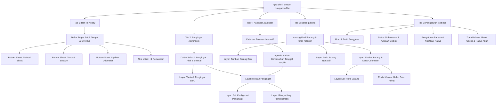
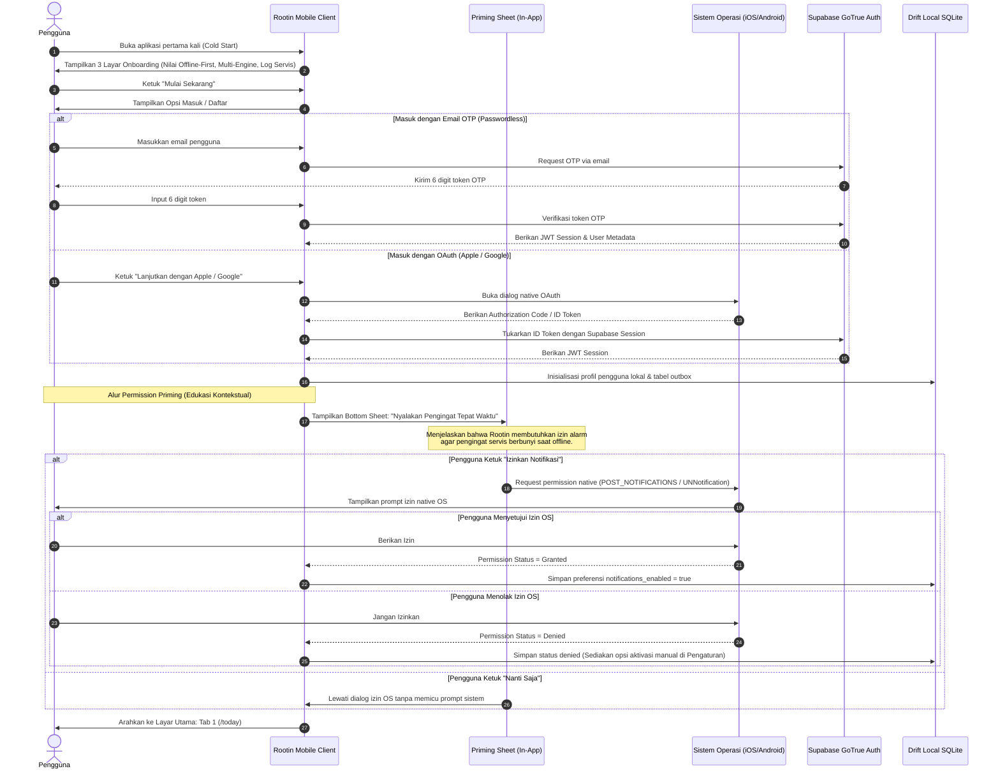
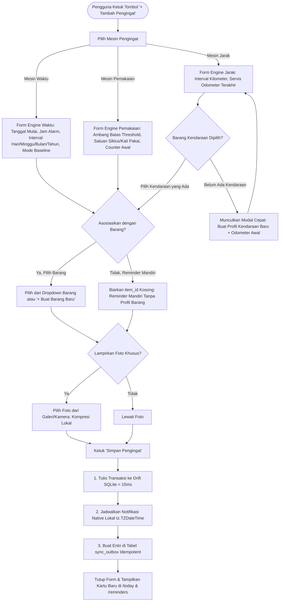
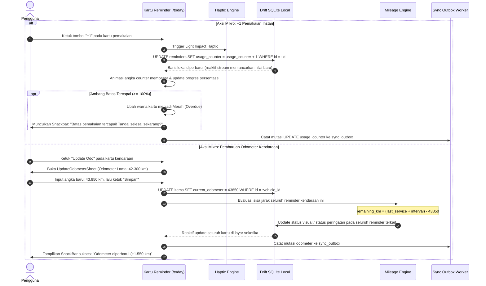
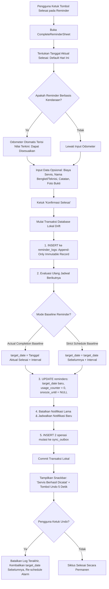
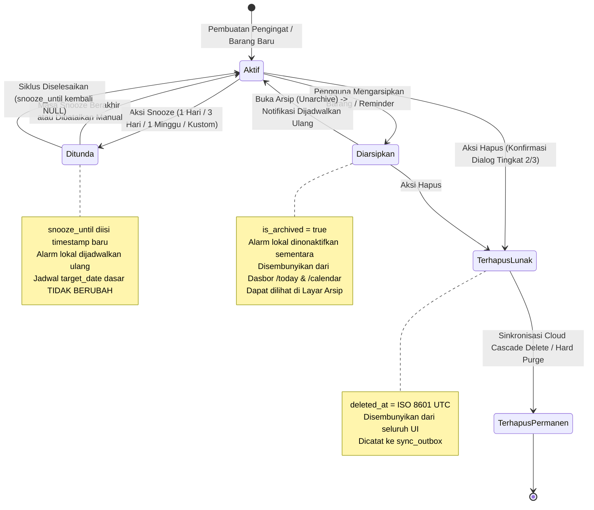
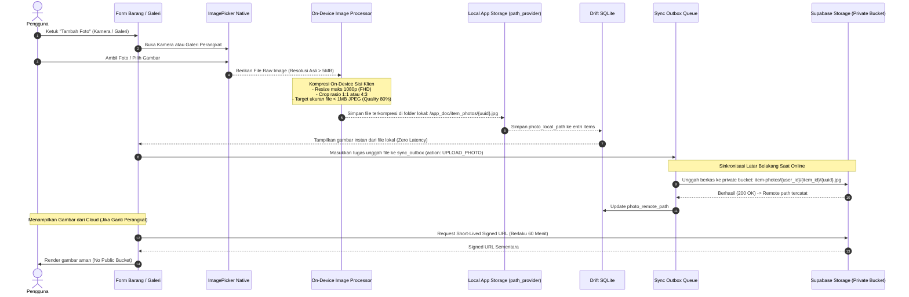
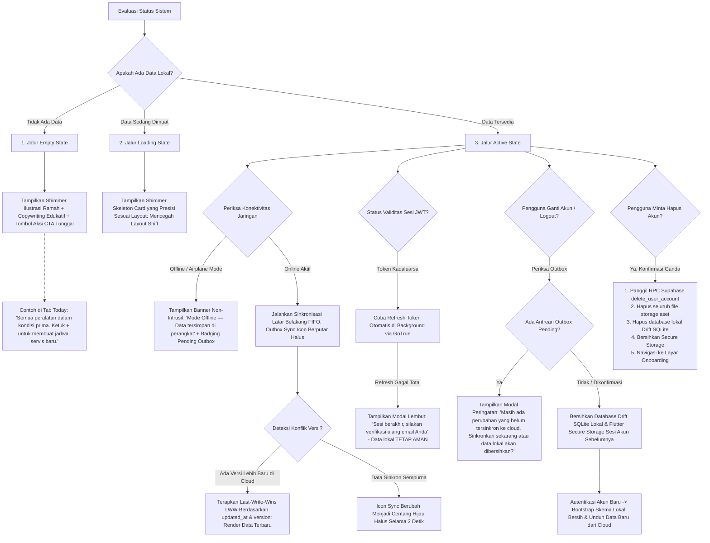

# Arsitektur Informasi & Alur Pengguna (Information Architecture & User Flows)
## Rootin Mobile — iOS & Android Native Experience

* **Status**: Approved / Design Baseline RFC
* **Tanggal**: 2026-10-24
* **Tiket Referensi**: ROOTIN-M004 (GitHub Issue [#3](https://github.com/andresanjaya/rootin/issues/3))
* **Target Implementasi**: ROOTIN-M005 (Design System & Tokens), ROOTIN-M006 s/d M020 (Presentation & Feature Screens)
* **Framework Acuan**: Flutter 3.x+ (Dart 3.x+) | `go_router` Declarative Stateful Shell

---

## 1. Ringkasan Eksekutif & Prinsip Desain UX Mobile

Rootin Mobile dirancang secara murni (*greenfield mobile-first*) untuk memenuhi kebutuhan pengguna dalam mengelola pemeliharaan aset pribadi, peralatan rumah tangga, dan kendaraan secara cepat, tanpa hambatan jaringan (*true offline-first*), serta berpusat pada kenyamanan penggunaan satu tangan (*one-handed ergonomics*).

Dokumen ini mendefinisikan **Information Architecture (IA)**, **7 Alur Pengguna (User Flows)** terperinci, dan **Evaluasi Navigasi Adaptif Platform** (iOS Cupertino vs Android Material 3) yang terisolasi total dari ekosistem Rootin Web.

### 1.1 Prinsip Desain Antarmuka Rootin Mobile

1. **Ergonomi Jempol (*Thumb Zone Focused*)**:
   - 90% interaksi operasional harian (pengecekan agenda, konfirmasi servis selesai, penambahan counter pemakaian, dan pembaruan odometer) dapat dijangkau di area bawah layar (*one-handed reachability zone*).
   - Penggunaan modal sheet bawah (*bottom sheet*) dinamis sebagai kontainer interaksi cepat daripada modal dialog melayang di tengah layar.
2. **Kemandirian Aset Fleksibel (*Decoupled & Optional Associations*)**:
   - Reminder dapat berdiri mandiri (*standalone reminder*) tanpa mengharuskan pengguna mendaftarkan profil barang terlebih dahulu.
   - Pendaftaran foto barang bersifat opsional untuk mengeliminasi friksi awal (*zero-friction onboarding*).
3. **Resiliensi Status Sistem (*Universal State Handling*)**:
   - Setiap layar memiliki representasi eksplisit untuk 5 kondisi antarmuka: **Empty**, **Loading (Skeleton Shimmer)**, **Active/Populated**, **Offline/Syncing**, dan **Error/Conflict**.
   - Tidak ada antarmuka yang terblokir (*freeze*) akibat kegagalan sinyal jaringan.
4. **Pencegahan Tindakan Destruktif (*Safe Destructive Actions*)**:
   - Tindakan berisiko tinggi (penghapusan aset, penghapusan permanen reminder, penghapusan akun) dilindungi dialog konfirmasi bertingkat dengan pengetikan nama objek atau verifikasi identitas.
   - Aksi penyelesaian dan penundaan reminder menyediakan tombol *Undo* langsung via Snackbar kontekstual.
5. **Nol Dependensi Desktop/Web (*Zero Web Heritage*)**:
   - Tidak mengadopsi pola desktop seperti multi-column table dense, menu sidebar menyempit, atau pagination angka. Navigasi mengadopsi pola native *Stateful Shell Tab Bar* yang mempertahankan posisi scroll antar tab.

---

## 2. Information Architecture (IA)

### 2.1 Peta Navigasi Hierarkis Aplikasi

Aplikasi menggunakan struktur kontainer tunggal berbasis `StatefulShellRoute.indexedStack` dari `go_router`, yang menyematkan **5 Tab Utama pada Bottom Navigation Bar**. Setiap tab mempertahankan riwayat navigasi (*navigation stack*) dan posisi gulir (*scroll offset*) secara independen.

```
+--------------------------------------------------------------------+
|                   ROOT APP SHELL (StatefulShellRoute)              |
+--------------------------------------------------------------------+
                                    |
     +---------------+--------------+--------------+---------------+
     v               v              v              v               v
+-----------+  +----------+   +----------+   +----------+    +----------+
|  Tab 1:   |  |  Tab 2:  |   |  Tab 3:  |   |  Tab 4:  |    |  Tab 5:  |
| Hari Ini  |  |Pengingat |   |  Barang  |   | Kalender |    |Pengaturan|
|  /today   |  |/reminders|   |  /items  |   |/calendar |    |/settings |
+-----------+  +----------+   +----------+   +----------+    +----------+
```

#### Diagram Hubungan Informasi Antarmuka



### 2.2 Rincian Layar Induk & Layar Anak per Tab

| Tab & Rute URI | Layar Induk (*Primary Screen*) | Layar Anak & Modal (*Child Stacks & Sheets*) | Elemen Kunci Antarmuka |
| :--- | :--- | :--- | :--- |
| **Tab 1: Hari Ini**<br>`/today` | **Dasbor Fokus Harian** | - *Bottom Sheet Selesai Siklus*<br>- *Bottom Sheet Snooze*<br>- *Bottom Sheet Update Odometer*<br>- *Snackbar Undo* | - Banner Status Offline & Outbox Pending<br>- Ringkasan metrik (Overdue, Hari Ini, 7 Hari Mendatang)<br>- Kartu tugas interaktif dengan tombol aksi instan |
| **Tab 2: Pengingat**<br>`/reminders` | **Daftar Komprehensif Pengingat** | - `/reminders/new` (*Form Builder*)<br>- `/reminders/:id` (*Detail Screen*)<br>- `/reminders/:id/edit`<br>- `/reminders/:id/logs` (*Audit Trail*) | - Filter chips: Waktu, Pemakaian, Jarak<br>- Search bar filter judul pengingat & nama barang<br>- Floating Action Button (FAB) `+ Pengingat` |
| **Tab 3: Barang**<br>`/items` | **Katalog Profil Aset & Inventaris** | - `/items/new` (*Form Tambah Barang*)<br>- `/items/:id` (*Detail Barang & Odometer*)<br>- `/items/:id/edit`<br>- `/items/archived` (*Daftar Arsip*)<br>- *Sheet Foto Picker & Cropper* | - Segmented filter kategori: Kendaraan, Elektronik, Furnitur, Fasilitas, Lainnya<br>- Kartu ringkasan barang (foto thumbnail, jumlah reminder aktif, status odometer)<br>- Tombol switch Arsip Barang |
| **Tab 4: Kalender**<br>`/calendar` | **Tampilan Agenda Bulanan & Mingguan** | - `/calendar/day/:date` (*Agenda Harian*)<br>- *Navigasi langsung ke Reminder Detail* | - Kalender interaktif dengan indikator titik warna status (Merah: Overdue, Oranye: Warning, Netral: Terjadwal)<br>- Daftar agenda di bawah kalender yang reaktif terhadap tanggal yang diketuk |
| **Tab 5: Pengaturan**<br>`/settings` | **Pusat Preferensi & Manajemen Akun** | - `/settings/account` (*Profil & Sesi*)<br>- `/settings/notifications` (*Izin & Jam*)<br>- `/settings/sync` (*Detail Outbox*)<br>- `/settings/language` (ID / EN)<br>- *Dialog Hapus Akun (Danger Zone)* | - Kartu avatar & identitas email pengguna<br>- Switch tema (Sistem, Terang, Gelap)<br>- Indikator konektivitas & jumlah antrean sinkronisasi lokal<br>- Zona Bahaya (*Destructive Zone*) |

Implementasi M021: halaman `/settings` dapat dicapai dari ikon pengaturan di beranda; memilih bahasa perangkat/Indonesia/English, km/mi, zona waktu perangkat atau override IANA, dan jam dinding pengingat per akun. Nilai disimpan lokal pada perangkat ini; jadwal notifikasi dan sinkronisasi preferensi antarperangkat belum tersedia (M019/kontrak sinkronisasi berikutnya). String layar autentikasi dan beranda menggunakan ARB ID/EN; panjang teks mengikuti ukuran font sistem.

---

### 2.3 Desain Modal Sheets & Dialog Aksi Cepat

Untuk menjaga alur kerja pengguna tetap efisien, aksi operasional tidak memaksa transisi layar penuh (*full-screen route transition*), melainkan disajikan dalam bentuk modal lembar bawah (*bottom sheet*) ergonomis:

#### A. Modal Sheet: Aksi Instan `+1` Pemakaian (Usage Counter)
- **Pemicu**: Tombol melayang `+1` langsung pada kartu reminder pemakaian di tab `/today` atau `/reminders`.
- **Perilaku**:
  - Menyediakan umpan balik getaran ringan (*haptic feedback light impact*).
  - Nilai counter dinaikkan seketika di database lokal Drift SQLite (< 15 ms).
  - Tampilan visual counter beranimasi membesar (*scale pop animation*).
  - Jika nilai counter telah mencapai ambang batas (`usage_counter >= usage_threshold`), kartu bertransisi seketika ke status warna merah (*Overdue*) dan memunculkan snackbar penawaran: *"Batas pemakaian tercapai. Tandai selesai sekarang?"*.

#### B. Modal Sheet: Pembaruan Odometer Kendaraan (`UpdateOdometerSheet`)
- **Pemicu**: Tombol "Update Odometer" pada kartu kendaraan di tab `/today` atau `/items/:id`.
- **Struktur Antarmuka**:
```
  +---------------------------------------+
  |                [=====]                |  <- Handle bar
  | Perbarui Odometer Kendaraan           |
  | Toyota Avanza (B 1234 CD)             |
  +---------------------------------------+
  | Odometer Terakhir : 42.300 km         |
  |                                       |
  | [ Angka Odometer Baru (km) ]          |
  | [ 43.850                ]             |
  | -> Penambahan: +1.550 km              |
  |                                       |
  | [  Simpan Pembaruan Odometer  ]       |
  +---------------------------------------+
```
- **Validasi Bisnis**:
  - Jika angka baru < angka lama: Memunculkan peringatan kuning (*Warning*): *"Angka odometer lebih rendah dari catatan sebelumnya (42.300 km). Lanjutkan jika ada penggantian speedometer atau koreksi salah input."* (Pengguna diberi opsi konfirmasi eksplisit).
  - Menyimpan mutasi ke Drift SQLite dan secara otomatis memicu pembaruan kalkulasi sisa jarak (*cascading recalculation*) pada seluruh reminder jarak yang terikat pada kendaraan tersebut.

#### C. Modal Sheet: Penyelesaian Siklus Perawatan (`CompleteReminderSheet`)
- **Pemicu**: Tombol centang bulat (*Done*) pada kartu pengingat.
- **Form Interaktif**:
  1. **Tanggal Aktual Selesai (*Actual Completion Date*)**: Default tanggal hari ini (tersedia tombol date picker untuk memasukkan tanggal riil jika pekerjaan dilakukan kemarin).
  2. **Odometer Saat Servis** (Khusus Reminder Jarak/Kendaraan): Terisi otomatis dengan nilai `current_odometer` kendaraan terkini, dapat disesuaikan.
  3. **Biaya Perawatan (*Service Cost*)**: Kolom input opsional dalam mata uang lokal (Rupiah).
  4. **Teknisi / Tempat Servis (*Performed By*)**: Kolom teks opsional (contoh: "Bengkel Resmi", "Mandiri").
  5. **Catatan Tambahan (*Notes*)**: Catatan spesifik (contoh: "Ganti oli merk X 5W-30 + filter oli").
  6. **Lampiran Foto Kuitansi/Bukti**: Tombol opsional untuk menyematkan foto fisik.
- **Konsekuensi Aksi**:
  - Mencatat baris baru yang bersifat **immutable (hanya tambah)** ke tabel `reminder_logs`.
  - Menghitung ulang tanggal jatuh tempo berikutnya (`target_date`) berdasarkan mode baseline (*Actual Completion* vs *Strict Schedule*).
  - Me-reset status tunda (`snooze_until = NULL`).
  - Menampilkan toast sukses dengan tombol *Undo* berdurasi 5 detik.

#### D. Modal Sheet: Penundaan Jadwal (`SnoozeSheet`)
- **Pemicu**: Tombol "Tunda" (*Snooze*) pada kartu pengingat atau aksi geser kartu (*swipe action*).
- **Pilihan Cepat**:
  - `+1 Hari` (Besok pada jam notifikasi yang sama).
  - `+3 Hari` (Akhir pekan / 3 hari mendatang).
  - `+1 Minggu` (7 hari kalender).
  - `Pilih Tanggal Spesifik` (Membuka dialog pemilih tanggal).
- **Jaminan Invarian Sistem**:
  - Mengisi atribut `snooze_until` di database lokal dan menjadwalkan ulang notifikasi lokal perangkat.
  - **Sama sekali tidak mengubah baseline `target_date` dasar**. Jadwal jangka panjang tetap konsisten.

---

### 2.4 Dialog Konfirmasi Tindakan Berisiko (*Destructive Safeguards*)

Untuk mencegah kehilangan data secara tidak sengaja (*unintended data loss*), aplikasi menetapkan standar verifikasi bertingkat:

```
Tingkat Risiko 1 (Rendah)     -> Hapus Log Servis Tunggal     -> Dialog Konfirmasi 1 Tombol Batal/Hapus
Tingkat Risiko 2 (Menengah)   -> Hapus Pengingat Berulang     -> Dialog Konfirmasi + Penjelasan Dampak Riwayat
Tingkat Risiko 3 (Tinggi)     -> Hapus Profil Barang          -> Dialog Konfirmasi Eksplisit + Ketik Nama Barang
Tingkat Risiko 4 (Kritis)     -> Hapus Akun Pengguna          -> Re-autentikasi Sandi/OTP + Ketik "HAPUS AKUN"
```

#### Spesifikasi Dialog Hapus Profil Barang (Tingkat Risiko 3)
```
+---------------------------------------+
|  Hapus Barang Ini Secara Permanen?    |
+---------------------------------------+
| Tindakan ini akan menghapus barang    |
| "Honda Vario 160", beserta:           |
| * 4 pengingat servis aktif            |
| * 12 catatan riwayat pemeliharaan     |
| * 2 foto galeri privat                |
|                                       |
| Data yang dihapus tidak dapat         |
| dipulihkan kembali.                   |
|                                       |
| Ketik "Honda Vario 160" untuk         |
| mengonfirmasi:                        |
| [ Honda Vario 160                 ]   |
|                                       |
| [    Batal    ]  [ Hapus Permanen ]   |  <- Tombol aktif jika teks cocok
+---------------------------------------+
```

---

## 3. Alur Pengguna Terperinci (Detailed User Flows)

### 3.1 Flow 1: Onboarding, Autentikasi & Permission Priming

Alur masuk pengguna mengedepankan pendekatan edukasi sebelum meminta izin sistem native (*contextual permission priming*), guna memaksimalkan tingkat persetujuan (*opt-in rate*) notifikasi lokal.



---

### 3.2 Flow 2: Pembuatan Reminder Pertama (Waktu, Pemakaian, Jarak)

Mendukung fleksibilitas penuh: reminder dapat dibuat dengan atau tanpa asosiasi profil barang. Foto profil maupun bukti sepenuhnya bersifat opsional.



---

### 3.3 Flow 3: Aksi Cepat Reminder (+1 Pemakaian & Update Odometer)

Interaksi mikro yang dirancang untuk dieksekusi dalam waktu kurang dari 3 detik langsung dari daftar tugas.



---

### 3.4 Flow 4: Penyelesaian Siklus (Actual Completion Date)

Ketika pemeliharaan telah dilakukan, siklus diselesaikan dengan mencatat log permanen tanpa mengubah aturan historis masa lalu.



---

### 3.5 Flow 5: Siklus Lanjutan (Tunda/Snooze, Arsip, Hapus Permanen)



---

### 3.6 Flow 6: Manajemen Profil Barang & Galeri Foto Privat

Menjaga privasi penuh: gambar dikompresi di perangkat dan diunggah ke *private bucket* Supabase Storage tanpa akses URL publik.



---

### 3.7 Flow 7: Jalur State Sistem Lengkap (Edge Cases & Resilience)

Mengatur respons antarmuka pada setiap status sistem yang tidak terduga:



#### 3.7.1 Jalur Empty State (Kondisi Kosong Edukatif)
- **Tampilan Tab `/today`**: Jika tidak ada tugas servis yang overdue atau jatuh tempo dalam 7 hari mendatang, layar tidak dibiarkan putih kosong. Ditampilkan ilustrasi peralatan dalam kondisi terawat, label teks *"Semua peralatan dalam kondisi prima"*, dan tombol CTA sekunder *"Lihat Kalender Mendatang"* atau `+ Buat Pengingat`.
- **Tampilan Tab `/reminders`**: Menampilkan panduan cepat 3 langkah membuat reminder (Waktu, Pemakaian, atau Jarak) dengan tombol CTA utama `+ Tambah Pengingat`.
- **Tampilan Tab `/items`**: Menampilkan ilustrasi katalog dengan pesan *"Belum ada barang terdaftar. Reminder tetap bisa dibuat mandiri tanpa profil barang"*, dilengkapi tombol `+ Tambah Barang Baru`.

#### 3.7.2 Jalur Loading Skeleton (Pencegahan Layout Shift)
- Saat data dibaca dari Drift SQLite (cold boot pertama) atau pemuatan halaman detail, antarmuka tidak menggunakan *circular spinner* di tengah layar yang memblokir pandangan.
- Menggunakan **Shimmer Skeleton Card** yang memiliki proporsi dimensi 1:1 terhadap kartu pengingat asli (tinggi kartu, posisi chip filter, dan letak tombol aksi) untuk mengeliminasi lonjakan visual (*cumulative layout shift*).

#### 3.7.3 Jalur Banner Offline & Indikator Pending Outbox
- **Banner Status**: Ketika konektivitas jaringan terputus (airplane mode atau sinyal hilang), bilah banner tipis berwarna amber muncul di bagian atas layar: *"Mode Offline — Seluruh perubahan tersimpan aman di perangkat"*. Banner tidak menutupi tombol navigasi dan tidak memblokir input formulir.
- **Badging Outbox**: Pada tab Pengaturan (`/settings`), terdapat badge penghitung real-time (misal: `3 Pending Sync`) yang mengindikasikan berapa banyak mutasi lokal yang sedang menunggu koneksi internet untuk dikirim ke Supabase.

#### 3.7.4 Jalur Penanganan Error & Pemulihan Konflik (Conflict Recovery)
- **Strategi Resolusi Konflik**: Menggunakan aturan **Last-Write-Wins (LWW)** deterministik berbasis timestamp UTC `updated_at` dan nomor sekuensial `version`. Jika terdapat pembaruan dari perangkat lain yang lebih baru, baris lokal diselaraskan secara otomatis di latar belakang tanpa melempar pop-up kesalahan yang membingungkan pengguna.
- **Retry dengan Exponential Backoff**: Mutasi outbox yang gagal akibat galat server (HTTP 5xx) dijadwalkan ulang secara otomatis dengan jeda eksponensial (2s, 4s, 8s, 16s, hingga batas maksimal 60 detik) sebelum menandai status retry pada kartu audit.

#### 3.7.5 Jalur Ganti Akun & Isolasi Data Lokal (Account Switch)
- **Pencegahan Kebocoran Data Antar-Pengguna**: Mengingat database Drift SQLite berada di media penyimpanan lokal perangkat, perpindahan akun (*Account Switch / Logout*) mewajibkan pembersihan total state lokal untuk menjamin privasi.
- **Pengecekan Outbox Sebelum Logout**: Jika masih ada antrean mutasi outbox lokal yang belum tersinkronisasi ke cloud, sistem memunculkan dialog konfirmasi kritis: *"Perhatian: Ada 2 perubahan lokal yang belum terunggah ke cloud. Melanjutkan keluar akan membatalkan perubahan tersebut."* Opsi yang diberikan: `Batal`, `Coba Sinkron Sekarang`, atau `Tetap Keluar & Hapus Data Lokal`.
- **Bootstrap Sesi Baru**: Setelah berhasil login dengan akun baru, database lokal diinisialisasi ulang dari kondisi bersih dan memicu sinkronisasi satu arah dari Supabase (*initial pull*).

#### 3.7.6 Jalur Penghapusan Akun Permanen (Right to be Forgotten)
- Mematuhi standar privasi data dan regulasi toko aplikasi (Apple App Store & Google Play):
  1. Pengguna wajib melewati dialog konfirmasi bertingkat dan mengetik teks `"HAPUS AKUN"` secara presisi.
  2. Klien memanggil fungsi aman Supabase RPC `delete_user_account()`.
  3. Menghapus seluruh file foto privat pada Supabase Storage.
  4. Menghapus file database lokal `app.db` (Drift SQLite) dari sandbox aplikasi.
  5. Menghapus seluruh token JWT dan kunci enkripsi dari Flutter Secure Storage.
  6. Mengarahkan pengguna kembali ke alur Onboarding awal.

---

## 4. Evaluasi Navigasi Mobile Native vs Website

### 4.1 Mengapa 5 Tab Bottom Navigation Dipilih?

Rootin Mobile secara sadar menolak pola navigasi Rootin Web (yang menggunakan topbar horizontal dan hamburger menu di sudut kiri atas) dan memilih **5 Tab Bottom Navigation Bar**:

1. **Ergonomi Jangkauan Jempol (*Thumb Zone Arc*)**:
   - Berdasarkan studi antropometri interaksi perangkat layar sentuh modern (layar 6.1" hingga 6.7"), area sepertiga bawah layar adalah zona paling natural dan nyaman untuk dijangkau tanpa perlu meregangkan jempol atau memindahkan tumpuan genggaman tangan (*hand repositioning*).
   - Menempatkan seluruh navigasi inti di bawah secara drastis mengurangi risiko perangkat terjatuh saat digunakan dalam kondisi riil (misalnya saat pengguna berada di garasi memegang kunci pas atau senter).
2. **Kerapatan Informasi & Batas Kognitif Visual**:
   - Prinsip *Human Interface Guidelines* (Apple) dan *Material Design 3* (Google) menetapkan batas maksimal 5 item pada bottom navigation bar agar label teks tidak terpotong dan target sentuh (*touch target*) tetap memenuhi standar aksesibilitas minimum **48 x 48 dp**.
   - 5 Tab yang dipilih membagi domain perhatian pengguna secara terisolasi tanpa tumpang tindih:
     - **Hari Ini (`/today`)**: Fokus aksi operasional mendesak hari ini.
     - **Pengingat (`/reminders`)**: Manajemen dan pencarian seluruh jadwal perawatan.
     - **Barang (`/items`)**: Katalog fisik inventaris, spesifikasi teknis, dan foto.
     - **Kalender (`/calendar`)**: Proyeksi horizontal terhadap waktu dan anggaran.
     - **Pengaturan (`/settings`)**: Konfigurasi teknis, profil, dan keamanan.

---

### 4.2 Evaluasi Posisi Kalender & Pengaturan

*Pertanyaan Arsitektur*: Mengapa Kalender dan Pengaturan ditempatkan sebagai tab navigasi utama tingkat pertama (*first-class navigation citizen*), dan bukan sebagai sub-menu tersembunyi?

#### A. Rasional Kalender sebagai Tab Mandiri (Bukan Sub-Filter di Daftar Pengingat)
- **Keterbatasan Daftar Vertikal (*List View Bias*)**: Daftar vertikal sangat baik untuk mengurutkan prioritas berdasarkan tanggal jatuh tempo terdekat, namun gagal memberikan gambaran kepadatan agenda (*schedule density*).
- **Proyeksi Finansial & Waktu Luang**: Pengguna seperti Budi Santoso atau Siti Rahma membutuhkan visualisasi kapan pengeluaran servis akan menumpuk. Dengan membuka Kalender, mereka dapat melihat tanggal-tanggal yang memiliki titik merah/oranye (*heat dots*) dan segera mengetahui bahwa minggu ketiga bulan depan memiliki 4 jadwal servis bersamaan (servis mobil, perpanjangan STNK, dan servis 2 unit AC).
- **Perencanaan Mandiri**: Menjadikan Kalender sebagai tab mandiri memberikan akses langsung satu ketukan tanpa harus membuka form filter berlapis.

#### B. Rasional Pengaturan sebagai Tab ke-5 (Bukan Profil di Header Atas)
- **Aksesibilitas Satu Tangan**: Pada aplikasi web, avatar profil lazim diletakkan di sudut kanan atas. Pada ponsel berlayar besar, sudut kanan atas adalah area paling sulit dijangkau (*hardest-to-reach zone*).
- **Transparansi Status Sinkronisasi Offline**: Pada aplikasi offline-first, pengguna butuh kepastian kapan data mereka terakhir disinkronkan, berapa antrean outbox yang tersisa, dan opsi manual sinkronisasi. Menempatkan Pengaturan di tab bawah memberikan visibilitas tinggi dan menumbuhkan rasa percaya pengguna (*user trust*).

---

### 4.3 Pola Navigasi Adaptif Platform: Android (Material 3) vs iOS (Cupertino)

Rootin Mobile menggunakan Flutter untuk menyajikan pengalaman native yang menghormati konvensi masing-masing sistem operasi:

| Dimensi UX | Android (Material 3) | iOS (Cupertino) |
| :--- | :--- | :--- |
| **Navigasi Balik (*Back Navigation*)** | - Mendukung tombol back fisik dan *Predictive Back Gesture* bawaan Android 14+.<br>- Transisi layar horizontal meluncur dengan skala halus (*MaterialPageTransitionsTheme*). | - Mendukung *Interactive Full-Edge Swipe Back Gesture* (`CupertinoPageRoute`).<br>- Transisi geser horizontal dengan efek bayangan dan paralaks breadcrumb. |
| **Bilah Judul (*Top App Bar*)** | - `TopAppBar` Material 3 dengan warna kontainer permukaan (*surface tint elevation*).<br>- Judul sejajar di kiri atau tengah dengan aksi di kanan. | - `CupertinoSliverNavigationBar` dengan *Large Title collapsing effect* saat pengguna menggulir ke bawah.<br>- Efek blur kaca buram (*frosted glass translucency*). |
| **Bilah Tab Bawah (*Bottom Navigation Bar*)** | - `NavigationBar` Material 3 dengan pill seleksi aktif melingkar (*active indicator pill*).<br>- Ketinggian elevasi 80 dp tanpa bayangan tajam. | - `CupertinoTabBar` dengan latar belakang transparan/blur yang tembus pandang (*vibrancy blur*).<br>- Ikon SF Symbols dengan label teks kompak. |
| **Lembar Aksi Bawah (*Bottom Sheets*)** | - Modal Bottom Sheet dengan sudut melengkung 28 dp di sudut atas (*rounded top corners*), drag handle bar di tengah. | - Cupertino Action Sheet / Modal Sheet dengan gaya inset mengambang dan tombol terpisah untuk aksi batal. |
| **Umpan Balik Haptik (*Haptic Feedback*)** | - `HapticFeedback.lightImpact()` pada aksi mikro counter dan switch.<br>- `HapticFeedback.vibrate()` pada kondisi error/destructive. | - `UIImpactFeedbackGenerator(style: .light)` untuk seleksi.<br>- `UINotificationFeedbackGenerator` (success / warning / error). |
| **Penanganan Area Aman (*Safe Area*)** | - Kompensasi punch-hole kamera depan dan bilah gestur navigasi bawah Android. | - Kompensasi Dynamic Island / Notch di atas dan Home Indicator Bar di bawah layar. |

---

### 4.4 Penegasan Ketiadaan Ketergantungan pada Alur Website Rootin Web

Untuk mengeliminasi ambiguitas teknis pada seluruh siklus pengembangan, ditetapkan batasan tegas berikut:

1. **Bebas dari Pola Desain Web**:
   - Rootin Mobile tidak menggunakan komponen *WebView*, iframe, atau tautan tersembunyi yang membuka browser eksternal untuk fungsionalitas inti.
   - Tidak ada ketergantungan pada URL routing web, skema query params browser, atau cookie session. Seluruh state navigasi dikelola secara native melalui token memori Dart dan `go_router`.
2. **Kemandirian Siklus Rilis & Database**:
   - Seluruh endpoint API terikat pada instance Supabase Mobile independen. Kegagalan deployment, perubahan skema, atau downtime pada Rootin Web sama sekali tidak berdampak pada Rootin Mobile.
3. **Logika Bisnis Sisi Klien Penuh**:
   - Kalkulasi kabisat, clamping akhir bulan, perhitungan persentase keausan, dan kalkulasi sisa kilometer dieksekusi 100% di perangkat menggunakan *Pure Dart Domain Engine*, bukan melalui panggilan REST API backend.

---

## 5. Panduan Transisi ke Sistem Desain (Bridge to M005)

Dokumen UX ini menjadi spesifikasi acuan langsung bagi tiket **ROOTIN-M005 (Design System & Tokens)**. Rincian kebutuhan komponen antarmuka yang wajib disiapkan adalah:

1. **Komponen Kartu Pengingat (`ReminderCard`)**:
   - Varian Waktu (menampilkan tanggal jatuh tempo, sisa hari, dan badge baseline).
   - Varian Pemakaian (menampilkan progress bar linier, angka counter, dan tombol aksi `+1`).
   - Varian Jarak Tempuh (menampilkan odometer target, sisa km, dan tombol "Update Odo").
2. **Token Warna Status Reaktif**:
   - `status-normal` (Hijau/Netral): Kondisi aman, pemakaian < 80%, sisa jarak > 500 km.
   - `status-warning` (Kuning/Oranye): Mendekati jatuh tempo, pemakaian 80%-99%, sisa jarak 1-500 km.
   - `status-overdue` (Merah Solid): Jatuh tempo terlewati, pemakaian >= 100%, sisa jarak <= 0 km.
   - `status-snoozed` (Ungu/Abu Aksen): Ditunda hingga tanggal tertentu.
3. **Standar Aksesibilitas Mobile (WCAG 2.1 AA)**:
   - Target sentuh interaktif (*interactive touch target*) minimal **48 x 48 dp**.
   - Rasio kontras teks terhadap latar belakang minimal **4.5:1** untuk teks normal dan **3:1** untuk teks tebal/besar.
   - Dukungan penuh terhadap fitur pembesaran font sistem perangkat (*Dynamic Type & Font Scaling*).
